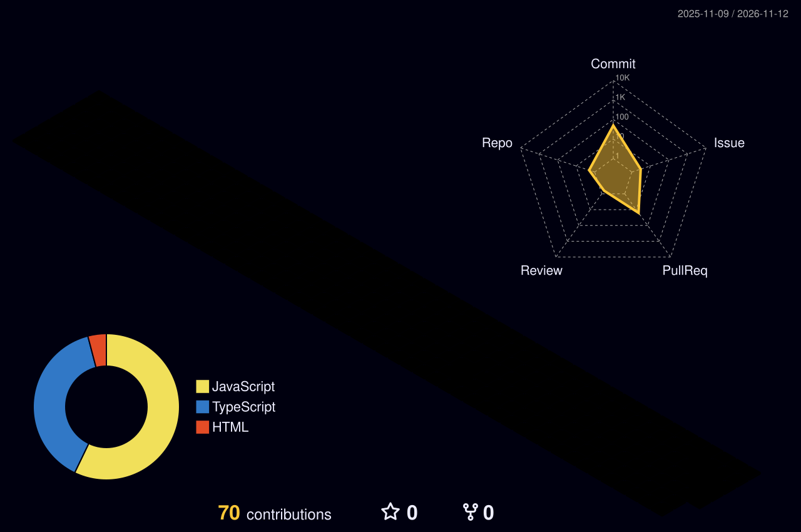

 

**Software engineering · AI-assisted products · Automation architecture · Digital systems**

### Hey, I'm Ahmed 👋

I build **software that connects ideas, people and operations**—from responsive web applications to intelligent automation, integrated business platforms, and AI-powered workflows. My work sits where **full-stack engineering, applied AI, data, and practical business problems** intersect.

I'm especially interested in systems that do more than display information: tools that **orchestrate processes, uncover problems, automate repetitive work, and make complex operations simpler**.

<table>
<tr><td width="50%" valign="top">

**What I build**

- Full-stack websites, dashboards, and internal tools
- AI integrations, agent workflows, and API-connected systems
- Automation pipelines, data processing, and backend services
- Technical SEO diagnostics and performance-focused web experiences

</td><td width="50%" valign="top">

**How I approach engineering**

- Start with the real user and operational problem
- Design modular, maintainable architecture
- Measure behavior, failures, and results—not just features
- Favor useful automation over unnecessary complexity

</td></tr>
</table>

### Technology toolkit

Also working across REST APIs, workflow orchestration, n8n, SEO intelligence, browser and data automation, and AI-assisted application development. Tool familiarity does not imply every technology is used in every public repository.

### Featured code & experiments

I keep the public showcase grounded in **actual public repositories**. The section below is refreshed automatically from GitHub metadata; new public, non-fork repositories can be discovered without editing the README by hand.

<!-- AUTO-PROJECTS:START -->
<table>
<tr>
<td width="50%" valign="top"><a href="https://github.com/Ahmed8xdev/barber-shop"><strong>💈 barber-shop</strong></a>  A Next.js project with a motion- and 3D-capable front-end stack.  Next.js · TypeScript · React · Three.js · GSAP</td>
<td width="50%" valign="top"><a href="https://github.com/Ahmed8xdev/studio"><strong>✦ studio</strong></a>  A Next.js application codebase featuring Genkit, Firebase, and a rich UI stack.  Next.js · TypeScript · Firebase · Genkit</td>
</tr><tr>
<td width="50%" valign="top"><a href="https://github.com/Ahmed8xdev/toolshub"><strong>🛠️ toolshub</strong></a>  An agent-facing tool hub including a documentation helper and delay calculator, with a Three.js background.  HTML · JavaScript · Tailwind CSS · Three.js</td>
<td width="50%" valign="top"><strong>＋ More projects as they go public</strong>  The scheduled discovery workflow scans accessible public repositories and refreshes this showcase and the complete <a href="./PROJECTS.md">project index</a>.  Public GitHub repositories only · no private code exposed</td>
</tr>
</table>
<!-- AUTO-PROJECTS:END -->

<a href="./PROJECTS.md">View the complete project index →</a>

### Engineering focus

| Area | What I work on |
|:--|:--|
| **Applications & platforms** | Full-stack products, business websites, dashboards, API integrations, database-backed systems |
| **AI & automation** | Agent workflows, prompt and tool orchestration, repeatable business processes, n8n, data pipelines |
| **Search & performance** | Search Console workflows, technical SEO investigation, indexability, speed and structured data |
| **Operations & reliability** | Linux-based deployment, containers, observability, maintainable workflows, resilient integration design |

### My GitHub activity, in 3D

Generated from real GitHub contribution activity by a scheduled GitHub Action. No fabricated contribution data or manually inflated statistics.

### Beyond the repository

My interests extend beyond isolated code samples: turning technical audits into decisions, building business automations that keep running reliably, and bridging software delivery with measurable digital outcomes. Some client and production work is not available as open-source code.

**Build thoughtfully. Automate responsibly. Ship things that matter.**

[View source projects](https://github.com/Ahmed8xdev?tab=repositories) · [Explore project index](./PROJECTS.md)

