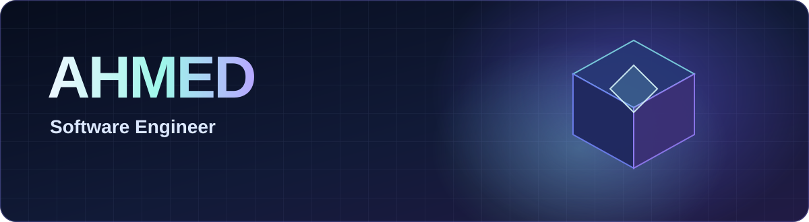

<h1>Ahmed | Software Engineer</h1>

<strong>Full Stack Development · MCP Servers & Integrations · Reverse Engineering · AI Agents · Automation</strong>

## Hello, I'm Ahmed 👋

I build software that connects people, data, tools and operations. My focus combines **full stack software engineering, backend development, AI agent orchestration, Model Context Protocol (MCP) development, reverse engineering, API integrations and intelligent automation**.

I work with **Python** for application logic, data processing, scripting and software analysis; **IDA Pro** as part of a reverse engineering and binary inspection toolkit; and **PHP with Laravel** for modern backend applications, database backed systems and service APIs. My engineering interests also cover React, Next.js, TypeScript, Node.js, security research, n8n workflows, technical SEO and cloud infrastructure.

I care about readable code, clear interfaces, useful integrations, solid failure handling and accurate measurement. My public repositories show selected projects; production and client work may not have public source code.

## Engineering capabilities

<table>
<tr>
<td width="50%" valign="top">
<h3>🧠 MCP Development & AI Integrations</h3>

Model Context Protocol servers, MCP tools and resources, tool calling, agent integration, API adapters, structured context, authentication aware connectivity, agentic orchestration and AI assisted workflows.

</td>
<td width="50%" valign="top">
<h3>🔍 Reverse Engineering & Software Analysis</h3>

IDA Pro, Python scripting, binary inspection, static analysis, software structure exploration, debugging concepts and authorized security research. Connecting low level understanding with practical engineering decisions.

</td>
</tr>
<tr>
<td width="50%" valign="top">
<h3>🌐 Full Stack Web Applications</h3>

PHP, Laravel, Next.js, React, TypeScript, JavaScript, Node.js, Express, Django, Flask, REST APIs, databases, responsive UI and production minded application architecture.

</td>
<td width="50%" valign="top">
<h3>⚙️ Intelligent Automation</h3>

Python automation, n8n, task orchestration, data pipelines, workflow agents, third party integrations, automated reporting, retries, monitoring and reproducible GitHub Actions.

</td>
</tr>
<tr>
<td width="50%" valign="top">
<h3>🛡️ Systems & Reliability</h3>

Linux, Docker, Kubernetes, containerized services, backend integration, PostgreSQL, MySQL, MongoDB, security minded design, operational diagnostics and deployment automation.

</td>
<td width="50%" valign="top">
<h3>📈 Technical SEO & Search Intelligence</h3>

Technical site audits, crawlability, indexability, structured data, sitemap architecture, performance analysis, Google Search Console, search intent and evidence based web improvements.

</td>
</tr>
</table>

## Technology stack

<strong>Languages, frameworks and interfaces</strong>

 

<strong>Databases, infrastructure and tooling</strong>

Tool names describe my areas of focus, not a claim that every technology is implemented in every public repository. Inspect the linked source code for project specific evidence.

## Featured source projects

The following project cards are derived from real public repositories. A daily GitHub Action discovers new public source repositories and refreshes this section automatically while preserving the rest of the profile.

<!-- AUTO-PROJECTS:START -->
<table>
<tr>
<td width="50%" valign="top"><a href="https://github.com/Ahmed8xdev/barber-shop"><strong>💈 barber-shop</strong></a>  A Next.js front end with a 3D- and motion-capable visual stack.  Next.js · React · TypeScript · Three.js · GSAP</td>
<td width="50%" valign="top"><a href="https://github.com/Ahmed8xdev/studio"><strong>✦ studio</strong></a>  A Next.js application codebase integrating Firebase, Genkit and a substantial UI component system.  Next.js · TypeScript · Firebase · Genkit · CSS</td>
</tr>
<tr>
<td width="50%" valign="top"><a href="https://github.com/Ahmed8xdev/toolshub"><strong>🛠️ toolshub</strong></a>  An agent utility dashboard with documentation and delay tools and a Three.js visual background.  HTML · JavaScript · Tailwind CSS · Three.js</td>
<td width="50%" valign="top"><strong>Explore more projects</strong>  <a href="https://github.com/Ahmed8xdev?tab=repositories">All public repositories</a></td>
</tr>
</table>
<!-- AUTO-PROJECTS:END -->

<a href="./PROJECTS.md">Explore the complete public project index →</a>

## 3D GitHub contributions

Generated from GitHub's real contribution history. Activity is not fabricated and there are no manually inflated contribution statistics.

## Interactive 3D experience

My portfolio includes a **native Three.js 3D scene**, built with WebGL geometry, physically based materials, lighting, orbiting objects, responsive layouts and direct pointer and keyboard interaction. This is real browser rendered 3D code rather than a prerecorded animation.

The 3D environment complements my technical work across **Python, PHP, Laravel, IDA Pro, reverse engineering, MCP server development, MCP integrations, AI agents, JavaScript, TypeScript, React, Next.js, Node.js, databases, Docker, Kubernetes, Linux, n8n and software automation**.

[**Explore the interactive 3D source code**](./docs/index.html) · [GitHub Pages publishing guide](./SEARCH_VISIBILITY.md)

GitHub README files cannot run interactive JavaScript. The Three.js implementation works in a browser once GitHub Pages is enabled for the docs directory.

## What I build and explore

<table>
<tr><th>Engineering area</th><th>Practical focus</th></tr>
<tr><td><strong>Protocol and agent engineering</strong></td><td>MCP servers, Model Context Protocol tools, integrated AI agents, LLM tool calling, external API connectivity and workflow orchestration</td></tr>
<tr><td><strong>Software research</strong></td><td>IDA Pro, Python scripting, reverse engineering, binary inspection, debugging and security research within authorized environments</td></tr>
<tr><td><strong>Web and backend applications</strong></td><td>PHP, Laravel, Python, Django, Flask, Next.js, React, Node.js, TypeScript, API design and database architecture</td></tr>
<tr><td><strong>Business automation</strong></td><td>n8n workflows, data integration, automated reports, error handling, containerized services and scheduled operations</td></tr>
<tr><td><strong>Search and performance</strong></td><td>Google Search Console, technical SEO, metadata, structured data, crawling, indexability, page performance and search visibility analysis</td></tr>
</table>

## Connect and explore

<strong>Build thoughtfully. Integrate intelligently. Ship useful software.</strong>

<a href="https://github.com/Ahmed8xdev">GitHub profile</a> · <a href="https://github.com/Ahmed8xdev?tab=repositories">Source repositories</a> · <a href="./PROJECTS.md">Project details</a> · <a href="./docs/index.html">Interactive 3D source</a> · <a href="./SEARCH_VISIBILITY.md">Search Console setup</a>

---

<!-- MUSIC FLOW FOOTER START -->

  

  <table align="center">
    <tr>
      <td align="center">
        
      </td>
    </tr>
  </table>

  

<!-- MUSIC FLOW FOOTER END -->
